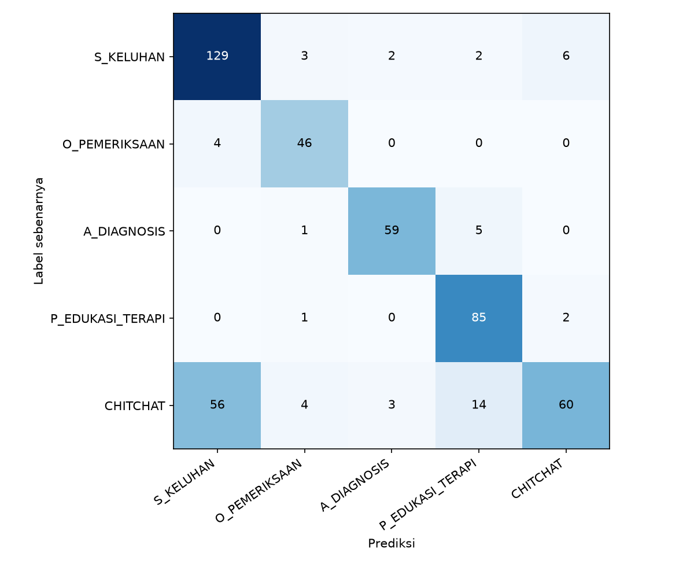

# LAPORAN EVALUASI — Fase 5 (per 2026-11-16)

Laporan hasil evaluasi dua modul ML yang dilatih sendiri. Cara mereproduksi setiap angka ada di
[`EVALUASI.md`](EVALUASI.md). Angka mentah ada di `reports/text_intent/<eksperimen>/metrics.json`.

**Status ringkas**

| Modul | Status | Angka utama |
|---|---|---|
| ML-2 Clinical Intent | Dilatih & dievaluasi pada data **sintetis** (template + dialog LLM) | macro-F1 test 0.806 (split grup), 0.851 ± 0.043 (6 seed); 0.687 pada domain shift template → LLM |
| ML-2, uji data nyata (E4) | **Belum**: belum ada sesi role-play terverifikasi | — |
| ML-1 Speaker Role | **Belum dilatih**: belum ada rekaman role-play manusia | hanya uji sintetis di `pytest` |

Semua angka ML-2 di bawah berasal dari data sintetis. Angka itu adalah **batas atas optimistis**, bukan
kinerja pada percakapan klinis nyata. Klaim kinerja nyata baru sah setelah E4 (§5).

---

## 1. Lingkungan

| Komponen | Versi |
|---|---|
| Python / scikit-learn | 3.11.9 / 1.9.1 (`.venv` laptop server) |
| Generator data LLM | Ollama 0.40.16, `qwen2.5:7b` (845dbda0ea48, 4.7 GB), GPU RTX 4050 6 GB |
| Model ML-2 | TF-IDF word (1–2 gram) + char_wb (3–5 gram, `min_df` 2) + one-hot peran → Logistic Regression (C 4, `class_weight` balanced) |

## 2. Data ML-2

| Sumber | Baris | Grup | Distribusi label (S / O / A / P / CHITCHAT) |
|---|---|---|---|
| `synthetic_template` | 1650 | 66 template × 25 varian | 550 / 300 / 200 / 300 / 300 |
| `synthetic_llm` | 789 | 60 dialog (20 kasus × 6 gaya pasien, kombinasi unik) | 277 / 120 / 61 / 175 / 156 |
| `human_verified` | 0 | — | — |

### 2.1 Pembuatan data LLM dan masalah yang ditemukan
1. **File LLM lama kosong (root cause).** Default script `--model qwen2.5:7b` belum terpasang. Saat diganti
   `qwen2.5:3b` dengan `temperature 0`, model looping mengulang satu kalimat pasien. Ollama tidak membatasi
   panjang output (`num_predict` tak terbatas + context shift), sehingga request berjalan > 400 s tanpa hasil.
2. **Perbaikan generator:** temperature 0.7, `top_p` 0.9, `repeat_penalty` 1.1, `num_predict` 2500,
   `maxItems` 30, satu contoh format di prompt, seed per dialog (reprodusibel), dan `flush` per dialog.
3. **Kebocoran yang dicegah:** script lama memilih (kasus, gaya) dengan pengembalian. Dengan
   temperature 0, prompt identik menghasilkan dialog identik di dua grup berbeda → bocor ke test.
   Sekarang kombinasi diambil tanpa pengembalian.
4. **3B vs 7B:** dengan sampling yang sama, 3B menghasilkan dialog ±9 baris dengan label sering salah
   (mis. "Kemungkinan Anda memiliki asma" → `O_PEMERIKSAAN`). 7B: 60/60 dialog valid, 8–23 baris
   (median 13), ±28 s/dialog.

### 2.2 Audit label LLM (n = 50, seed 7)
Sampel acak 50 dari 789 baris diperiksa terhadap pedoman anotasi (README §6). Rincian per baris:
`data/synthetic/audit_llm_labels.jsonl`.

| Hasil | Jumlah |
|---|---|
| Label LLM benar | **41 / 50 (82.0%)** → estimasi noise label ±18% |
| Salah, dikoreksi | 9 |
| Benar tetapi multi-intent (satu kalimat memuat 2 intent) | 5 (diterima, dicatat) |

| Pola kesalahan | n | Contoh |
|---|---|---|
| Balasan tanpa isi diberi label fase dialog | 5 | "Baik Dok." → `O_PEMERIKSAAN` (seharusnya `CHITCHAT`) |
| Salam + pertanyaan anamnesis diberi `CHITCHAT` | 2 | "Selamat pagi Pak, teruskan dengan cerita keluhan Anda" → `S_KELUHAN` |
| Pertanyaan pasien tentang penyakit | 2 | "Ya dok, apa sih itu?" (setelah dokter menyebut vertigo) → `A_DIAGNOSIS` |

Karena pola pertama sistematis, aturan pedoman "iya/baik dok tanpa isi = `CHITCHAT`" diterapkan ke
seluruh file (`audit_llm_labels.py fix-ack`): 6 baris tambahan dikoreksi. Total 15 baris dikoreksi;
label asli LLM disimpan di field `label_llm`.

**Catatan penting:** audit dilakukan oleh agent (Claude), bukan oleh anggota kelompok. Disarankan satu
anggota (idealnya yang paham klinis) meninjau ulang file audit sebelum presentasi. Selain label,
isi klinis dialog LLM kadang keliru (mis. "obat antiviral" untuk DBD). Ini tidak memengaruhi tugas
klasifikasi intent, tetapi dialog ini **tidak boleh** dipakai sebagai rujukan klinis.

## 3. Hasil ML-2

Semua eksperimen memakai split berbasis grup (template/dialog yang sama tidak pernah ada di train dan
test sekaligus) dan GroupKFold-5 pada train.

### 3.1 Ringkasan

| ID | Train → Test | n test | Accuracy | Macro-F1 | Weighted-F1 | CV macro-F1 (train) |
|---|---|---|---|---|---|---|
| E1 | template → template tak dikenal (14 template) | 350 | 0.671 | 0.630 | 0.678 | 0.720 ± 0.097 |
| E2 | template → **seluruh** dialog LLM | 789 | 0.708 | 0.687 | 0.708 | 0.785 ± 0.098 |
| E3 | template + LLM → grup tak dikenal (26 grup) | 482 | 0.786 | **0.806** | 0.770 | 0.826 ± 0.034 |

**Stabilitas E3:** split grup diulang dengan 6 seed (0–4 dan 42) → macro-F1 test **0.851 ± 0.043**
(rentang 0.806–0.933). Seed 42 (0.806) adalah yang terendah. Varians besar karena satu template = 25
kalimat hampir identik: satu template tak dikenal di test bisa menyumbang 25 error sekaligus (lihat §3.4).

Model produksi `models/text_intent/model.joblib` = E3 yang di-refit pada seluruh 2439 baris sintetis.

### 3.2 Perbandingan dengan baseline (macro-F1 test)

| Model | E1 | E2 | E3 |
|---|---|---|---|
| Baseline majority class | 0.105 | 0.104 | 0.091 |
| Baseline keyword rule (tanpa training) | 0.577 | 0.494 | 0.448 |
| LinearSVC | 0.633 | 0.672 | 0.798 |
| **Logistic Regression (dipakai)** | 0.630 | **0.687** | **0.806** |

Model terlatih mengungguli keyword rule +0.05 (E1) s.d. +0.36 (E3). Keyword rule jatuh di data LLM
karena variasi leksikal LLM jauh lebih kaya daripada daftar kata kunci. LogReg dan LinearSVC setara
(selisih ≤ 0.015). Keduanya menghasilkan probabilitas (LinearSVC lewat `CalibratedClassifierCV`).
LogReg tetap dipakai karena sedikit lebih tinggi di E2/E3 dan lebih sederhana: tidak butuh CV kalibrasi
internal, sehingga training lebih cepat. Pemilihan sebaiknya berdasar CV, bukan skor test.

### 3.3 Ablation fitur (macro-F1 test)

| Fitur | E1 | E2 | E3 |
|---|---|---|---|
| word + char + peran (dipakai) | 0.630 | **0.687** | **0.806** |
| word + char (tanpa peran) | 0.693 | 0.640 | 0.797 |
| word saja | 0.649 | 0.595 | 0.709 |
| char saja | 0.697 | 0.659 | 0.788 |

- **Char n-gram penting:** word saja selalu terendah. Char n-gram tahan terhadap typo, singkatan, dan
  bahasa campur ("rumhanya", "nyetuhin", "maketengah").
- **Fitur peran:** membantu di E2 (+0.047) dan E3 (+0.009), tetapi merugikan di E1 (−0.063). E1 hanya
  punya 14 template di test, sehingga satu template mengubah skor besar. Kesimpulan: efek peran positif
  pada data yang lebih bervariasi, tetapi belum konklusif. Perlu diuji ulang di E4.

### 3.4 Per kelas dan analisis error (E3)

| Kelas | Precision | Recall | F1 | Support |
|---|---|---|---|---|
| S_KELUHAN | 0.683 | 0.908 | 0.779 | 142 |
| O_PEMERIKSAAN | 0.836 | 0.920 | 0.876 | 50 |
| A_DIAGNOSIS | 0.922 | 0.908 | 0.915 | 65 |
| P_EDUKASI_TERAPI | 0.802 | 0.966 | 0.876 | 88 |
| CHITCHAT | 0.882 | **0.438** | 0.585 | 137 |

Kelemahan utama: **CHITCHAT sering diprediksi `S_KELUHAN`** (56 dari 137). Penyebab:
1. 64 dari 77 error CHITCHAT berasal dari 3 template utuh (c03, c04, c11), mis. "rumahnya jauh dari sini",
   "sudah dok, itu saja". Basa-basi bertopik non-medis yang tidak ada di train → model menebak `S_KELUHAN`
   (kelas terbesar). Data template hanya punya 12 template CHITCHAT; variasinya kurang.
2. Sisanya di data LLM, dan sebagian adalah **label LLM yang keliru**, bukan kesalahan model. Contoh:
   penutup "Kalau ada gejala baru datang ke sini ya" dilabel LLM `CHITCHAT`, diprediksi model
   `P_EDUKASI_TERAPI`. Menurut pedoman (rencana kontrol), prediksi model yang benar.

Dampak klinis: CHITCHAT yang masuk `S_KELUHAN` hanya menambah noise di bagian S rangkuman, dan setiap
butir rangkuman wajib punya `sumber` yang bisa dicek di UI review. Kesalahan sebaliknya (keluhan
dibuang sebagai CHITCHAT) lebih berbahaya, dan itu jarang: recall `S_KELUHAN` 0.908.

Confusion matrix E1 dan E2: `reports/text_intent/E1_template_only/confusion_matrix.png`,
`reports/text_intent/E2_template_to_llm/confusion_matrix.png`.

### 3.5 Domain shift (E2)
Model yang hanya dilatih pada template turun dari CV 0.785 ke 0.687 saat diuji pada dialog LLM
(−0.098). Kelas paling terdampak: `A_DIAGNOSIS` (F1 0.577) dan `CHITCHAT` (0.651).

Error terbesar E2: 62 kalimat berlabel `S_KELUHAN` diprediksi `CHITCHAT`. Dari 15 sampel acak error ini,
**11 adalah label LLM yang salah**:
- 4 balasan/terima kasih tanpa isi, di mana model justru benar. Contoh: "Baik dok, trims.", "Ya Dokter,
  saya pasti taat pada anjuran Anda."
- 5 pertanyaan pasien soal obat, kontrol, atau terapi, yang seharusnya `P_EDUKASI_TERAPI`. Contoh:
  "Baik Dok, apa obatnya?", "Nebulizer? Apa itu?"
- 2 pertanyaan pasien soal penyakitnya, yang ambigu. Contoh: "Apakah ini berbahaya?"

Hanya 4 dari 15 yang benar-benar error model, mis. "Parah, dok." dan "Perut terasa ngilu dari tadi pagi.".
Artinya, qwen2.5:7b cenderung memberi label `S_KELUHAN` ke hampir semua ucapan pasien. Noise label
pada subset PASIEN/`S_KELUHAN` kemungkinan jauh di atas estimasi rata-rata 18%. Konsekuensinya:
- skor E2 (dan bagian LLM di E3) **pesimistis** untuk kelas CHITCHAT/P pada ucapan pasien;
- model yang dilatih dengan data LLM ikut belajar bias "pasien = keluhan".

Rekomendasi: tinjau manual seluruh 217 baris PASIEN berlabel `S_KELUHAN` di data LLM. Jangan memakai
prediksi model untuk memilih baris yang dikoreksi; itu membuat label test bergantung pada model.

Penurunan dari CV ke E2 memberi gambaran kasar penurunan saat pindah ke percakapan nyata. Karena itu E4
wajib dilakukan.

## 4. ML-1 Speaker Role

**Belum ada hasil dari data nyata.** `runtime/training_data/speaker_role.jsonl` kosong. Data smoke test
Fase 1 sudah dipindah ke `runtime/_backup_smoke/` dan sengaja tidak dipakai. Hanya ada 2 anchor
dokter: dokter uji smoke test dan dokter TTS. Audio TTS/pitch-shift tidak dipakai untuk penilaian karena
terlalu mudah dipisahkan, jadi angkanya akan menyesatkan.

Bukti yang sudah ada hanya dari data sintetis di `pytest`:
`tests/test_ml_audio.py::test_trained_model_generalizes_to_unseen_doctor` melatih SVM pada fitur relatif
dari dokter A & B (suara sintetis berformant), lalu menguji pada dokter C yang tidak pernah dilihat.
Syarat lulus: akurasi ≥ 0.85. Test ini lulus (27/27 test hijau). Ini bukti bahwa mekanisme fitur relatif
berjalan, **bukan** metrik kinerja.

Yang dibutuhkan: role-play ≥ 3 dokter × ≥ 4 sesi sesuai SOP di `EVALUASI.md` §3. Setelah itu satu
perintah (`train_speaker_role.py`) menghasilkan test split-dokter, CV, perbandingan 4 model, baseline
heuristik anchor, dan ablation relatif vs absolut.

## 5. Yang masih harus dilakukan

| # | Langkah | Siapa | Output |
|---|---|---|---|
| 1 | Tinjau ulang `data/synthetic/audit_llm_labels.jsonl` (50 baris) | anggota kelompok | konfirmasi angka 82% |
| 1b | Tinjau 217 baris PASIEN/`S_KELUHAN` di data LLM (§3.5), lalu ulangi E2/E3 | anggota kelompok | data LLM lebih bersih |
| 2 | Role-play ≥ 3 dokter × ≥ 4 sesi, verifikasi di `/review` | kelompok | `runtime/training_data/*.jsonl` |
| 3 | E4: latih sintetis, uji `human_verified` | agent/kelompok | metrik intent pada data nyata |
| 4 | Training & evaluasi ML-1 | agent/kelompok | `models/speaker_role/metrics.json` + PNG |
| 5 | "Muat ulang model" di `/metrics` | kelompok | model baru aktif |

## 6. Keterbatasan
- Data ML-2 100% sintetis. Template punya variasi terbatas; dialog LLM membawa gaya bahasa dan bias
  qwen2.5:7b, serta noise label ±18% (audit 50 baris; interval kepercayaan lebar). Noise lebih tinggi
  pada ucapan pasien berlabel `S_KELUHAN` (§3.5).
- Satu kalimat bisa memuat dua intent (10% sampel audit). Skema satu label per utterance memaksa pilihan.
- Varians antar-split besar (±0.043) karena jumlah grup kecil; laporkan mean ± std, bukan satu angka.
- Belum diuji: overlap speech, code-switching di luar lexicon, transkrip ASR yang salah dengar (E1–E3
  memakai teks bersih, bukan keluaran Whisper).
